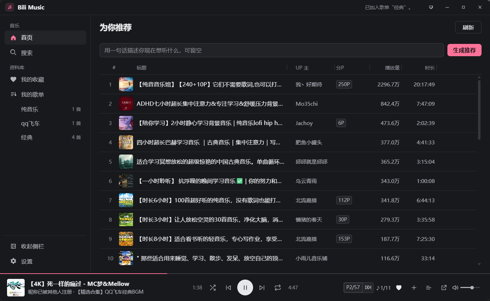
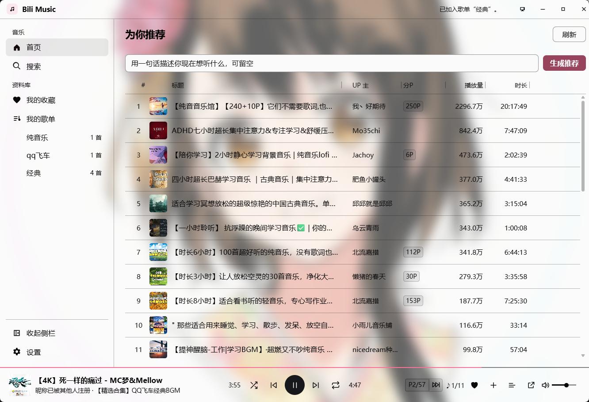
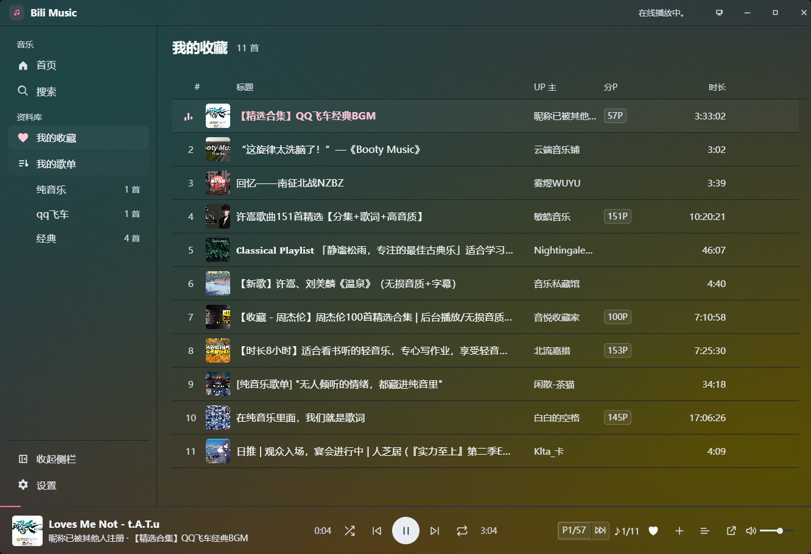
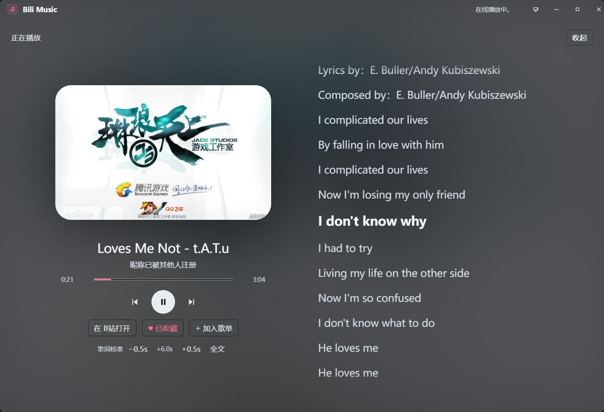

<div align="center">
  

  <h1>Bili Music</h1>

  <p><strong>把哔哩哔哩当作你的曲库。</strong><br />免登录、默认在线播放的 B 站音乐桌面播放器。</p>

  <p>
    <a href="https://github.com/Jmiao11/bili-music/releases/latest"></a>
    <a href="https://github.com/Jmiao11/bili-music/releases"></a>
    <a href="https://github.com/Jmiao11/bili-music/actions/workflows/ci.yml"></a>
    <a href="LICENSE"></a>
    <a href="https://github.com/Jmiao11/bili-music/stargazers"></a>
  </p>

  <p>
    
    
    
    
    
    
  </p>

  <p>
    <a href="https://github.com/Jmiao11/bili-music/releases/latest"><b>⬇️ 下载最新版</b></a>
    ·
    <a href="#-核心特性">功能</a>
    ·
    <a href="#-安装与运行">安装</a>
    ·
    <a href="#-贡献者">贡献者</a>
    ·
    <a href="CHANGELOG.md">更新日志</a>
  </p>
</div>

<!-- 📸 主截图：建议 1600×1000 左右，深色主题首页，正在播放一首多P视频 -->
<p align="center">
  
</p>

> [!WARNING]
> **非官方项目**：本项目与哔哩哔哩（bilibili）没有任何官方关联或背书，仅供个人学习与研究使用。详见文末 [法律声明](#️-法律声明与使用限制)。

> [!IMPORTANT]
> **从 0.8 及更早版本升级到 1.0：** 收藏、歌单或播放队列中一旦加入合集，数据会升级为新格式，旧版本将无法读取。程序会在首次升级前自动保留 `.v1.bak.json` 备份，仍建议升级前先在「设置 → 导出备份」中导出一份。

## 🎬 界面预览

<table>
  <tr>
    <td align="center" width="50%">
      <br />
      <sub><b>背景图主题</b> · 按图片亮度自动切换明暗</sub>
    </td>
    <td align="center" width="50%">
      <br />
      <sub><b>动态背景</b> · 从封面取色缓慢流动</sub>
    </td>
  </tr>
  <tr>
    <td align="center">
      <br />
      <sub><b>沉浸播放页</b> · 大封面与滚动歌词</sub>
    </td>
    <td align="center">
      <br />
      <sub><b>迷你播放器</b> · 置顶小窗</sub>
    </td>
  </tr>
</table>

## ✨ 这是什么

Bili Music 是一个基于 **Tauri v2 + Rust + Vue 3** 的桌面音乐播放器，把 B 站音乐区当作曲库来听歌。它和同类工具最大的不同，在于两条贯穿始终的设计原则：

- 🔒 **免登录**：默认走游客身份取流与搜索，全程不需要账号 `cookie`，没有封号顾虑。
- 💧 **按需缓存**：默认关闭磁盘缓存并在线流式播放；用户可主动开启内部音频缓存，设置容量上限、查看占用并随时清空。
- 🎚️ **音质选择**：设置或播放栏音质菜单可选最高可用、192K、132K、64K，下一次播放生效；播放栏显示实际档位，yt-dlp 显示“兜底”。各档是平台标称值，缓存与响度按实际音轨区分。

换句话说，它刻意没有走“登录账号 + 批量下载建库”那条更省事、但更有风险的路，而是把“零负担、零配置、隐私友好”作为产品核心。

## 🎧 核心特性

| 功能 | 说明 |
| --- | --- |
| 🔎 音乐搜索 | B 站音乐区搜索，本地相关性重排让原曲上浮，可按「单曲 / 合集」筛选，支持粘贴 BV 号直接播放 |
| 🏠 为你推荐 | 基于收藏、歌单与听歌记录，由 AI 生成检索意图再重排真实结果；未配置 Key 时显示热门榜单 |
| 📚 多 BV 合集 | 合集可作为一个条目收藏或加入歌单，与单曲混排拖拽；整体播放时按实际音频单元计数 |
| 📼 多 P 连播 | 多 P 视频自动连播，标题跟随分 P 切换；可一键跳过本视频剩余分 P |
| 🕘 最近播放 | 按最近播放时间回看200条视频，重播最近听过的分P；闪电标记显示当前音质下可离线命中的缓存 |
| 🗂️ 资料库 | 收藏与歌单，侧栏直达各歌单；可粘贴 B 站公开收藏夹链接批量导入，自动跳过失效条目 |
| ↔️ 可调列宽 | 表头分隔线可拖动调整标题、UP 主、分 P、播放量与时长列宽，双击恢复默认，宽度自动记忆 |
| 🪞 沉浸播放页 | 铺满窗口的大封面与滚动歌词，点击播放栏封面即可进入 |
| 🎤 自动歌词 | 自动识别歌曲并显示滚动歌词，支持 ±0.5s 校准、手动匹配与全文浏览 |
| 🌘 四种主题 | 深色 / 浅色 / 背景图 / 动态背景，另有六种强调色；背景图支持模糊与遮罩调节，0 档即原图 |
| 🪶 迷你播放器 | 一键收起为置顶小窗，继续切歌、暂停和收藏，跟随主窗口主题与背景 |
| 🪟 原生质感 | 自定义无边框标题栏；Windows 任务栏缩略图按钮，macOS 原生红绿灯 |
| ⌨️ 全局快捷键 | 上一首、播放 / 暂停、下一首等可在设置中自定义 |
| 🕑 听歌记录 | 本地记录真正听过的歌（长歌够 30s、短歌听完 90% 才算），持续加厚推荐口味 |
| 💾 数据备份 | 收藏、歌单、听歌记录、AI 配置与背景图一键导出为 zip，换机或重装一键导回 |
| 🎵 流式播放 | 经后端 Axum 本地代理在线播放并透传 `Range`；开启缓存后再次播放直接读取本地 |
| 🆕 新版本提示 | 启动时后台检查 GitHub 正式发布，首页提示新版本，点击前往发布页下载 |

## 🧠 技术亮点

> 这一节写给技术读者：项目里几个有意思的工程决策与难点。

<details>
<summary><b>1. 免登录游客取流</b></summary>

常见方案是登录账号，再用 `yt-dlp --cookies` 解析下载。本项目改成 **游客身份** 直接领取 `buvid` 票据，经 WBI 签名请求 `playurl` 拿到音频直链，全程不依赖登录态。

| 方案 | 首播耗时 |
| --- | --- |
| `yt-dlp`（旧方案，需 cookie） | ~12.79s |
| 游客直链（冷启动） | ~1.83s |
| 游客直链（热态） | ~0.54s - 0.91s |

`yt-dlp` 仍作为 **可选兜底** 保留，只在极少数游客取流失败时启用；默认分发版本不包含它，保持“双击即用”。

</details>

<details>
<summary><b>2. 真实风控场景下的游客搜索</b></summary>

无 `cookie` 首次搜索时，曾遇到返回 `v_voucher` 而不是正常数据。最终定位到根因是游客身份只拿到了 `buvid3`、缺了 `buvid4`。修复策略不是“强行上登录态”，而是把游客身份补领逻辑改成“缺任一项都走 SPI 补齐”。

</details>

<details>
<summary><b>3. 搜索展示与播放队列解耦</b></summary>

“搜索结果列表”和“真实播放队列”是两套独立状态：搜索只更新展示，只有点中某首歌时，才把当前展示列表升级成播放队列。这样搜索不会打断正在播放的歌，首页榜单、收藏、歌单也都复用同一套播放状态机。

</details>

<details>
<summary><b>4. 切歌不串台</b></summary>

快速切歌时，旧请求可能在新请求之后才返回。这里用 `requestVersion` 作为请求代号，并在登记代理 URL 前再做一次当前任务身份校验，确保迟到的旧结果一律作废，同时正确区分“真实解析失败”和“用户主动切歌取消”。

</details>

<details>
<summary><b>5. 单一 store + 同步渲染的 Vue 架构</b></summary>

界面全部由 Vue 渲染，但没有引入额外的状态库：整个应用只有一个深只读 store，每次提交都用完整快照同步渲染根组件，不依赖 `nextTick` 合批。配合结构共享与浅比较，列表高亮只重绘新旧两行，纯进度更新不重绘任何行；根渲染入口带防重入保护，焦点事件触发的嵌套提交会排队重放，不会打断正在进行的渲染。启动阶段的监听安装顺序被录制为基线，每次构建自动比对。

</details>

<details>
<summary><b>6. 多 P 与多 BV 合集的最小侵入接入</b></summary>

B 站大量音乐资源本质上是多 P 视频或多 BV 合集。项目没有推翻既有按 `BV` 组织的播放队列，而是旁挂分 P 游标、合集父层与显示快照；合集数据只在确实用到时才按需升级存储格式，并在首次升级前自动备份。

</details>

<details>
<summary><b>7. 本地数据原子写入</b></summary>

收藏、歌单、搜索历史都落在本地 JSON。写入走临时文件、备份、再重命名的原子方案，并处理 Windows 下重命名不能直接覆盖现有文件的细节。读取时文件损坏会显式报错，绝不会拿空数据覆盖坏文件。

</details>

<details>
<summary><b>8. 零幻觉的 AI 口味推荐</b></summary>

推荐链路约束成「LLM 只出意图、不出结果」：模型只负责 **生成检索关键词意图** 与 **对真实候选重排**；每一个最终出现的 `bvid` 都必须来自真实搜索结果并逐个校验，模型无法编造任何一首不存在的歌，这条不变量由回归测试保证。支持 OpenAI Chat、OpenAI Responses 与 Anthropic Messages 三种接口规范。

</details>

<details>
<summary><b>9. 搜索结果的本地相关性重排</b></summary>

B 站搜索的 `totalrank` 优化的是点击率：搜一首歌，几小时的合集和二创会靠热度压过原曲。项目在拿到结果后做一层本地重排，四项加权打分：关键词覆盖率（主信号）、时长合理性、精确短语命中、以及 B 站原始位次（弱先验）。覆盖率用 `|K∩T| / |K|` 而非 Dice 系数，避免误杀带长前缀的精确匹配。整套打分是纯逻辑，带完整单测。

</details>

## 🔧 技术栈

| 层 | 选型 |
| --- | --- |
| 框架 | [Tauri v2](https://tauri.app/) |
| 后端 | Rust · Cargo workspace · Axum 本地流代理 |
| 前端 | Vue 3 · TypeScript · Vite（单一 store，同步根渲染） |
| 取流 | 游客直链为主，[yt-dlp](https://github.com/yt-dlp/yt-dlp) 可选兜底 |
| 本地数据 | JSON（收藏、歌单、搜索历史、响度测量值、快捷键配置），原子写入 |
| CI / 发布 | GitHub Actions · Windows 与 macOS 双平台测试 · tag 触发自动构建 |

## 📦 安装与运行

> [!NOTE]
> 主要在 **Windows 10 / 11** 上开发与验证；**macOS** 由 [@liyu-1028](https://github.com/liyu-1028) 适配与测试，提供 Apple Silicon 与 Intel 两个版本。Linux 理论上 Tauri 可支持，但**未经测试**。

### 方式一：直接下载使用

前往 [Releases](https://github.com/Jmiao11/bili-music/releases/latest) 下载对应平台的安装包：

| 平台 | 文件 | 说明 |
| --- | --- | --- |
| Windows x64 | `Bili-Music-v版本号-windows-x64.zip` | 免安装，解压后运行 `bili-music.exe` |
| macOS Apple Silicon | `Bili-Music-v版本号-macos-arm64.dmg` | M1 / M2 / M3 / M4 |
| macOS Intel | `Bili-Music-v版本号-macos-x64.dmg` | |

- 免登录，默认纯游客模式，无需任何配置。
- 数据保存在系统用户目录（Windows：`%APPDATA%\bili-music\`；macOS：`~/Library/Application Support/bili-music/`），程序目录不留文件。
- macOS 安装包暂未做 Apple 公证。首次打开若提示「无法验证开发者」，在 Finder 中右键 App → 打开 → 再点「打开」。

### 方式二：从源码构建

#### 1. 前置依赖

| 依赖 | 说明 |
| --- | --- |
| [Rust](https://www.rust-lang.org/tools/install) | Edition `2021` |
| [Node.js](https://nodejs.org/) | `>=22.18.0 <23`，推荐 `22.23.3`（见 `.nvmrc`） |
| [Tauri CLI](https://tauri.app/) | `cargo install tauri-cli` |
| WebView2 Runtime | Windows 10/11 通常已自带；缺失时从微软官网安装 |

#### 2. 克隆并运行

```bash
git clone https://github.com/Jmiao11/bili-music.git
cd bili-music
npm ci

# 开发模式（会自动启动端口 1420 的 Vite 开发服务器）
cargo tauri dev

# 构建（Windows 免安装 exe 可加 --no-bundle）
cargo tauri build
```

构建产物位于 `target/release/`。

#### 3. 可选：启用 `yt-dlp` 兜底

默认游客模式已经能正常使用。若希望在极少数游客取流失败时保留兜底：

1. 下载 [`yt-dlp.exe`](https://github.com/yt-dlp/yt-dlp/releases)，放到 exe 同目录；开发模式下放到项目根的 `tools/yt-dlp.exe`。
2. 如该兜底需要 `cookie`，将 `cookies.txt`（Netscape 格式）放到同一目录。

> [!CAUTION]
> `cookies.txt` 含登录态，已被 `.gitignore` 忽略，请勿提交。`yt-dlp` 兜底只用于覆盖极个别游客无法取流的视频，并非必需。

## 🌟 贡献者

### 核心协作者

<table>
  <tr>
    <td align="center" width="180">
      <a href="https://github.com/liyu-1028">
        <br />
        <b>@liyu-1028</b>
      </a><br />
      <sub>macOS 平台负责人</sub>
    </td>
    <td>
      <b>没有 @liyu-1028，就没有 Bili Music 的 macOS 版本。</b>从数据目录、原生标题栏到 WKWebView 下的播放兼容，整个 macOS 平台由他一手适配、测试和维护；Windows + macOS 双平台自动构建也由他搭建，项目从此能稳定地同时发布三份安装包。
      <br /><br />
      他的贡献还远不止平台适配：
      <ul>
        <li>🍎 macOS 跨平台支持、原生红绿灯标题栏与全局快捷键</li>
        <li>🔊 修复 macOS 上新投稿无 DASH 音轨、mcdn 节点漂移、octet-stream 被拒绝解码导致的无法播放</li>
        <li>🏗️ Windows + macOS 双平台自动构建与发布流水线</li>
        <li>🤖 AI 推荐支持 OpenAI Responses 与 Anthropic Messages 接口规范（#28），修复推荐重排超时并提供降级（#64）</li>
        <li>🆕 首页新版本提示（#70）</li>
        <li>🪶 迷你窗短歌名遮挡与圆角显示修复（#27）；队列边界提示（#23）；搜索词恢复与加入歌单提示（#14）</li>
        <li>🧰 固定 Node.js 开发版本，统一本地与 CI 环境（#63）</li>
      </ul>
    </td>
  </tr>
</table>

### 特别感谢

- [@justasuka](https://github.com/justasuka) — 贡献了迷你悬浮播放器（#18）

### 所有贡献者

<a href="https://github.com/Jmiao11/bili-music/graphs/contributors">
  
</a>

### 致谢

- B 站接口整理参考了 [SocialSisterYi/bilibili-API-collect](https://github.com/SocialSisterYi/bilibili-API-collect)
- 歌词数据由第三方接口 [落月 API](https://doc.vkeys.cn/) 提供

## 🤝 参与贡献

欢迎提交 Issue 和 Pull Request。开发任何功能或提交 PR 前，请先阅读 [贡献指南](CONTRIBUTING.md) 和根目录的 [AGENTS.md](AGENTS.md)，其中规定了项目的架构、安全、验证与提交要求。

- 界面改动以 [界面规范](docs/ui-spec.md) 为准。
- 涉及提示、加载态、错误态、确认交互或跨窗口反馈时，遵守 [用户操作反馈规范](docs/notification-guidelines.md)。
- 不知道从哪里改起，可以先看 [改功能指南](docs/where-to-change.md)。

## 📈 Star History

<a href="https://star-history.com/#Jmiao11/bili-music&Date">
  
</a>

## ⚖️ 法律声明与使用限制

- 本项目为**非官方**第三方客户端，与哔哩哔哩（bilibili）无任何官方关联或背书，不使用其商标与标识；相关名称与商标归各自权利人所有。
- 本项目**仅供个人学习与研究使用**，**禁止任何形式的商业用途**，包括但不限于销售、收费服务、广告变现、商业集成等。
- 本项目不提供音视频下载、导出或打开缓存文件位置的功能；默认不会持久化音频。用户主动开启本地音频缓存后，应用会保存播放器内部缓存文件，仅用于播放优化，可在设置中清除；不绕过登录 / 会员权限，不破解任何 DRM 或加密措施。
- 数据来源于公开接口；使用时须遵守哔哩哔哩的《用户协议》《社区规则》及相关法律法规，不得用于批量爬取、恶意抓取等违反平台规则的行为。
- 使用本项目所产生的一切风险与责任由使用者自行承担；如权利人认为项目存在侵权或合规问题，请通过 Issue 联系，我会及时处理。

## 📄 许可

本项目以 [MIT License](LICENSE) 开源。本项目为非官方的第三方客户端，与 bilibili 无关，仅供学习研究；使用者需自行遵守 B 站及相关第三方接口的服务条款。

### 第三方依赖许可

本项目使用了以下采用非 MIT 许可证的依赖：

- [symphonia](https://github.com/pdeljanov/Symphonia) — MPL-2.0
- [tauri-plugin-global-shortcut](https://github.com/tauri-apps/plugins-workspace) — Apache-2.0 OR MIT

<div align="center">
  <br />
  <sub>由 Tauri + Rust + Vue 构建 · 仅供学习研究 · 如果这个项目对你有帮助，欢迎点一个 ⭐ Star</sub>
</div>
